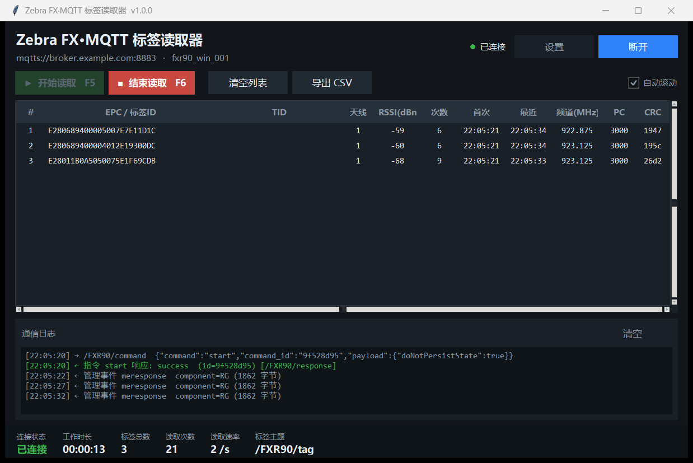

# Zebra FX·MQTT 标签读取器



Windows 桌面客户端：通过 MQTT(S) 订阅 Zebra FXR90（IoT Connector）的标签事件，
按 EPC 去重汇总成实时列表，并可用按钮控制读头开始/结束读取。

- 直接可用的程序：`dist\FXR90Reader.exe`（单文件，免安装，无需 Python）
- 源码：`fxr90_reader.py`（Python 3.10+ / tkinter / paho-mqtt 2.x）
- 配置：`config.json`（与 exe 同目录，改完重启程序生效）
- 📄 **完整项目文档（架构 / 模块 / 功能 / 界面 / 使用 / 踩坑）：[docs/项目发布文档.md](docs/项目发布文档.md)**

## 主题（由读头端 MQTT 端点配置决定）

| 用途 | 主题 | 方向 |
|---|---|---|
| 标签信息 | `/FXR90/tag` | 读头 → 本程序 |
| 设备返回报文（指令响应） | `/FXR90/response` | 读头 → 本程序 |
| 设备管理事件（心跳/健康） | `/FXR90/meresponse` | 读头 → 本程序 |
| 控制指令发送 | `/FXR90/command` | 本程序 → 读头 |

也支持 `+` / `#` 通配（如 `/FXR90/response/#`），在 `config.json` 里直接写即可。

## config.json 字段

| 字段 | 说明 | 默认 |
|---|---|---|
| host / port | 服务器地址 / 端口 | broker.example.com / 8883 |
| tls | 是否 TLS（mqtts） | true |
| verify_cert | 校验证书；自签才关 | true |
| ca_file | 自签 CA 的 pem 路径，可空 | "" |
| username / password | 认证 | mqtt / mqtt |
| client_id | 客户端 ID（多机运行要各不相同） | fxr90_win_001 |
| mqtt_version | "5" 或 "3.1.1" | "5" |
| keepalive | 心跳秒数 | 60 |
| tag_topic | 标签主题 | /FXR90/tag |
| response_topic | 指令响应主题 | /FXR90/response |
| management_topic | 管理事件主题 | /FXR90/meresponse |
| command_topic | 命令下发主题 | /FXR90/command |
| send_commands | 开始/结束是否真下发 start/stop 指令 | true |
| auto_connect | 启动即连接 | false |
| autoscroll | 新标签自动滚动 | true |

> 以 `_` 开头的键（如 `_说明`）是注释，程序加载时忽略。

## 使用

1. 双击 `dist\FXR90Reader.exe`
2. 点 `连接`（或直接点 `开始读取`，会自动先连接再开始）
3. `开始读取(F5)`：订阅标签主题、清零重计、并向 `/FXR90/command` 发
   `{"command":"start","command_id":"…","payload":{"doNotPersistState":true}}`
4. `结束读取(F6)`：退订、冻结工作时长、发 `stop`
5. 右键标签行：复制 EPC / 复制整行 / 查看原始 JSON；点表头可排序
6. `导出 CSV`：UTF-8 BOM，Excel 直接打开

状态栏：连接状态 · 工作时长 · 标签总数 · 读取次数 · 读取速率 · 标签主题。

命令行参数：`--auto` 启动即连接并开始（无人值守）、`--demo` 演示数据、
`--config <路径>` 指定另一份配置、`--selftest` 自检后退出（窗口版结果写 `selftest.txt`）。

## 行为说明

- **读头本来就在读时**，`start` 会回 `Failure: Start currently ongoing`，程序识别为
  “状态已符合要求”并按成功处理，不影响采集。
- **命令没响应**：3.5 秒后日志提示“未收到 start 指令响应”，本地订阅/计时照常工作；
  设置里可点“探测命令主题”自动试出可用主题。
- **断线**：paho 自动重连（2~15s 退避），重连成功后自动恢复本次读取。
- **多台电脑同时跑**：`client_id` 必须不同，否则 broker 会互踢（现象是反复断开重连）。

## 重新打包

```bash
uv pip install --python .venv/Scripts/python.exe paho-mqtt pyinstaller
.venv/Scripts/pyinstaller.exe --noconfirm --clean --onefile --windowed \
  --name FXR90Reader --icon tools/FXR90Reader.ico \
  --distpath dist --workpath build --specpath build fxr90_reader.py
cp config.json dist/config.json
```

图标由 `tools/make_icon.py` 生成（纯标准库，无 Pillow）。

## 自测

```bash
.venv/Scripts/python.exe fxr90_reader.py --selftest   # 解析 + 主题匹配
.venv/Scripts/python.exe test_live.py                 # 真连 broker，发 start 看响应与标签
.venv/Scripts/python.exe test_gui_live.py             # GUI 全流程（有现场数据也稳）
```
