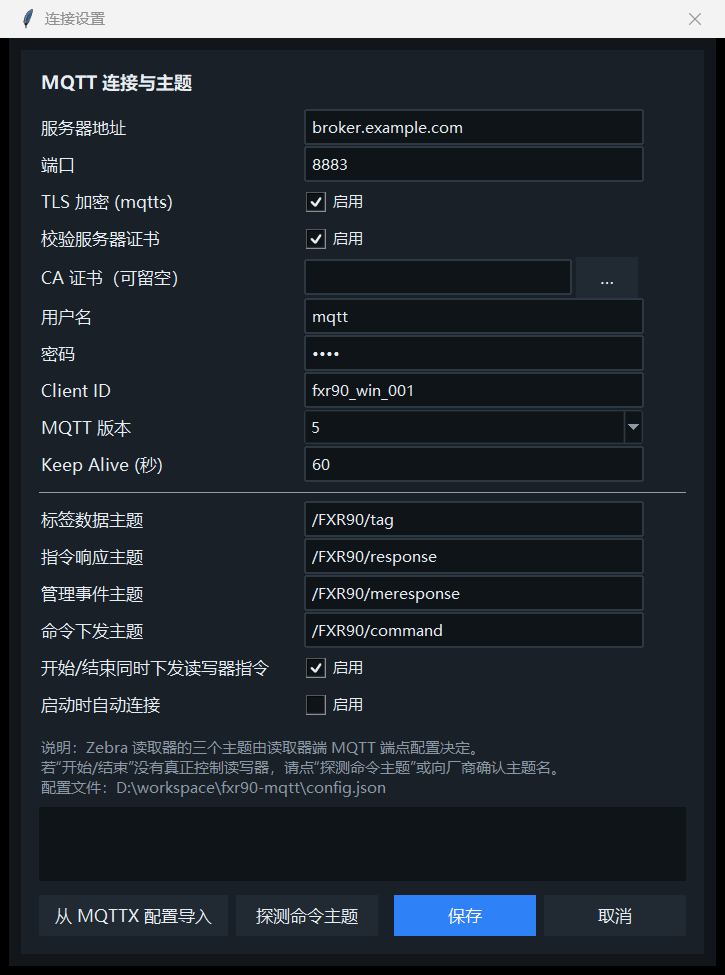
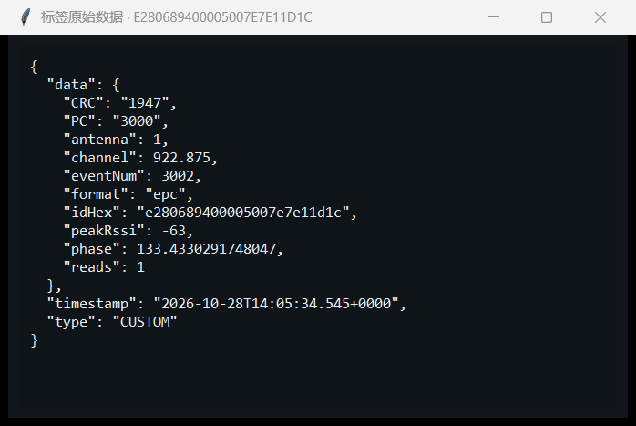

# Zebra FX·MQTT 标签读取器

> 一个面向现场的 Windows 桌面客户端：通过 MQTT 订阅 Zebra 固定式 RFID 读写器（FXR90 / FX9600 / FX7500 / ATR7000）的标签事件，实时汇总成标签表，并提供「开始读取 / 结束读取」控制、工作时长与标签数统计、CSV 导出。
>
> 版本 **v1.0.0** ｜ 单文件 exe，免安装 ｜ 已在 FXR90 真机（Zebra IoT Connector，MQTT over TLS）上跑通


---

## 一、为什么要写这个

Zebra 固定式读写器在「全云 / 混合」部署下，由读头里的 **Zebra IoT Connector** 把标签事件直接推给 MQTT Broker。官方文档给的验证方式是装一个 MQTTX 手工订阅主题看报文——现场用不了：

- 现场需要一个**点点点就能用**的界面：开始读、结束读、看读到了什么、导出一份给客户的表格；
- 官方客户端 Zebra RFID Reader 是配机工具，不负责"长期挂着采数据 + 统计 + 导出"；
- 标签事件是**逐条、重复**的（同一个 EPC 一秒内可能来十几条），直接刷在 MQTTX 里没法看，必须按 EPC 去重聚合；
- 「开始/结束读取」究竟有没有真正控到读头，需要一个能显示指令响应的界面，而不是靠猜。

于是有了这个工具：**一个 exe，一个 config.json，双击就能用**。

---

## 二、协议与主题

标签数据和管理事件由读头主动 publish，控制指令由客户端 publish，读头把结果回到响应主题。四类主题（本项目的默认值，来自现场读头的实际配置）：

| 用途 | 主题 | 方向 | 内容 |
|---|---|---|---|
| 标签信息 | `/FXR90/tag` | 读头 → 客户端 | 每条 EPC 读取事件 |
| 设备返回报文 | `/FXR90/response` | 读头 → 客户端 | 指令执行结果（`success` / `failure` + 原因） |
| 设备管理事件 | `/FXR90/meresponse` | 读头 → 客户端 | 心跳、天线状态、CPU、数据通道统计 |
| 控制指令发送 | `/FXR90/command` | 客户端 → 读头 | `start` / `stop` / `get_status` … |

> 主题名由**读头端的 MQTT 端点配置**决定，不是写死的协议常量。程序里四个主题全部可在 `config.json` / 设置界面里改，也支持 `+`、`#` 通配。

**标签事件（实测报文）：**

```json
{
  "data": {
    "CRC": "1947", "PC": "3000", "antenna": 1, "channel": 924.375,
    "eventNum": 665, "format": "epc", "idHex": "e280689400005007e7e11d1c",
    "peakRssi": -60, "phase": 176.62, "reads": 1
  },
  "timestamp": "2026-10-28T10:26:58.327+0000",
  "type": "CUSTOM"
}
```

**控制指令（start 的 payload 必填，stop 给 `{}`）：**

```json
{"command":"start","command_id":"1f2bb870","payload":{"doNotPersistState":true}}
{"command":"stop","command_id":"a91c77d2","payload":{}}
```

**指令响应：**

```json
{"command":"start","command_id":"1f2bb870","payload":{},"response":"success"}
```

---

## 三、技术架构

单进程、三层、双线程：**UI 主线程**只做界面，**paho 网络线程**只收包，中间用 `queue.Queue` 解耦——网络回调里绝不碰 Tk 控件。

```
┌──────────────────────────────────────────────────────────────────┐
│ UI 层（Tk 主线程，只做界面）                                     │
│   App(tk.Tk)                                                     │
│    ├─ 顶部：标题 / 状态灯 / 设置 / 连接·断开                     │
│    ├─ 操作条：开始读取 · 结束读取 · 清空 · 导出 CSV              │
│    ├─ 标签表：EPC / TID / 天线 / RSSI / 次数 / 首次 / 最近       │
│    ├─ 日志：TX 指令 / RX 响应 / 管理事件（折叠一行）             │
│    └─ 状态栏：连接 · 时长 · 标签总数 · 读取次数 · 速率           │
└──────────────────────────────────────────────────────────────────┘
             ▲  queue：tag / resp / mgmt / conn / log   （UI 只消费队列）
             │  用户操作：开始 / 结束 / 清空 / 导出
┌──────────────────────────────────────────────────────────────────┐
│ 服务层                                                           │
│   MqttLink —— paho-mqtt 2.x（独立网络线程 loop_start）           │
│    · 连接 / TLS / 重连退避 / 订阅 / 退订 / 发布指令              │
│    · 按主题分流：tag → 标签表，response → 指令日志               │
│   TagStore —— 纯数据结构，不依赖任何 UI                          │
│    · 按 EPC 去重：次数、RSSI 峰值、天线集合、首次/最近           │
└──────────────────────────────────────────────────────────────────┘
           │  JSON 读写
┌──────────────────────────────────────────────────────────────────┐
│ 配置层  config.json（与 exe 同目录，可手改 / 界面改）            │
│   host · port · tls · 证书 · 账号 · client_id · 四个主题         │
└──────────────────────────────────────────────────────────────────┘
```

**一次「开始读取」的完整链路：**

```
[点击开始读取 / F5]
   → 未连接？先 connect，并置 pending_start（由 on_connect 回调触发，不用定时器猜）
   → 清空上一轮统计、计时归零
   → SUBSCRIBE /FXR90/tag（QoS1）
   → PUBLISH /FXR90/command {"command":"start",...}
   ← 读头 PUBLISH /FXR90/response {"response":"success", "command_id":...}
   ← /FXR90/tag 持续到达 → 解析 → 聚合 → 批量刷表（80ms 节流）→ 状态栏刷新（250ms）
[点击结束读取 / F6]
   → UNSUBSCRIBE /FXR90/tag，冻结时长
   → PUBLISH /FXR90/command {"command":"stop",...}
```

**几个刻意的设计：**

| 问题 | 处理方式 |
|---|---|
| 标签事件高频、重复 | 按 `idHex` 去重聚合；`reads` 累加，`peakRssi` 取最大值，天线取集合；UI 80ms 批量刷新，不为每条报文重绘 |
| 读头本来就在读 | `start` 会返回 `Failure: Start currently ongoing`，程序识别为"状态已符合要求"，日志里说明而不是报错 |
| 指令没有响应 | 3.5 秒后提示"未收到 start 指令响应，本地采集不受影响"，退化为本地订阅/计时，功能不至于不可用 |
| 断线 | paho 自动重连（2~15s 退避），重连成功后自动恢复本次读取会话 |
| 时间戳是 UTC | `2026-10-28T10:26:58.327+0000` 解析后 `astimezone()` 转本地；"首次/最近"取时间戳 min/max，不按到达顺序 |
| 高 DPI 屏 | 启动即 `SetProcessDpiAwareness`，窗口尺寸按屏幕自适应，125% 缩放下不糊、不超出屏幕 |
| 无控制台 exe 崩溃 | 全局 `sys.excepthook` 写 `error.log` + 弹窗，不会"闪一下就没了" |

---

## 四、模块与代码结构

```
fxr90-mqtt/
├─ fxr90_reader.py        主程序（1,490 行，单文件，无第三方 UI 依赖）
├─ config.json            配置（外置，首次运行自动生成）
├─ README.md              简明使用说明
├─ docs/
│  ├─ 项目发布文档.md      本文件
│  └─ images/             截图（main / settings / raw）
├─ dist/
│  ├─ FXR90Reader.exe     发布版（单文件，13 MB，带图标）
│  ├─ config.json         随包配置
│  └─ 启动读取器.bat       双击启动
├─ tools/
│  ├─ make_icon.py        纯标准库生成 PNG/ICO 图标
│  ├─ shot.py             截图工具（GDI PrintWindow，支持 --live 真机截）
│  └─ cap.ps1             备用窗口截屏脚本
├─ test_live.py           真机链路测试（连接 → start → 收标签）
├─ test_gui_live.py       GUI 全流程测试（现场数据在跑也能断言）
└─ .venv/                 开发/打包环境（paho-mqtt + pyinstaller）
```

| 模块 | 类型 | 行数 | 职责 |
|---|---:|---:|---|
| `parse_tag_event()` | 函数 | ~45 | 解析单条报文，兼容 `data` 为对象或数组、单条或批量、大小写 EPC、坏 JSON |
| `topic_matches()` | 函数 | ~15 | MQTT `+` / `#` 通配匹配，决定消息走标签 / 响应 / 管理事件哪条通路 |
| `TagStore` | 类 | ~55 | 去重聚合：次数、RSSI 峰值、天线集合、首次/最近（min/max）、原始报文 |
| `MqttLink` | 类 | ~105 | paho 封装：TLS、重连、订阅、发布、按主题分流，回调只入队 |
| `SettingsDialog` | 类 | ~230 | 设置界面：16 个字段、MQTTX 配置一键导入、命令主题自动探测 |
| `App` | 类 | ~680 | 主窗口：样式、布局、会话控制、表格增量更新、排序、右键菜单、导出、日志、状态栏 |
| `selftest()` | 函数 | ~40 | 解析 + 主题匹配自检（8 组断言），无界面可跑 |
| `enable_dpi_awareness()` / `install_crash_handler()` | 函数 | ~30 | 高 DPI、崩溃兜底 |

依赖只有两个：**tkinter**（Python 自带）+ **paho-mqtt 2.x**。没有 PyQt、没有 Electorn、没有浏览器内核——打包 13 MB，启动 1 秒内。

---

## 五、功能清单

**连接**
- MQTT 5.0 / 3.1.1 可选，`mqtts`（TLS）或明文
- 证书校验默认开启，支持指定自签 CA；关校验需显式勾掉
- 自动重连（2~15 秒退避）；连接状态灯（灰=未连 / 绿=已连）
- Client ID 可配，多台电脑同时跑互不踢线

**读取控制**
- `开始读取`(F5)：订阅标签主题 + 清零重计 + 下发 `start`
- `结束读取`(F6)：退订 + 冻结时长 + 下发 `stop`
- 未连接时点"开始"会自动先连接，连上后自动开始（`pending_start` 机制）
- 指令下发与否可关（只做纯数据订阅的场景）

**标签列表**
- 列：`#` / `EPC` / `TID` / `天线` / `RSSI(dBm)` / `次数` / `首次` / `最近` / `频道(MHz)` / `PC` / `CRC`
- 同一 EPC 只占一行，`次数` 累加，`RSSI` 显示峰值，`天线` 显示该标签出现过的端口集合
- 点表头任一列排序（升/降切换），新标签到达时增量更新不闪屏
- 新标签短暂高亮，自动滚动可选
- 右键：复制 EPC / 复制整行 / 查看原始 JSON；双击也可看原始报文

**统计与导出**
- 状态栏：连接状态、工作时长 `HH:MM:SS`、标签总数（唯一 EPC）、读取次数（累计 reads）、读取速率（5 秒滑窗）
- 导出 CSV：12 列，UTF-8 BOM，Excel 直接打开，默认文件名带时间戳

**通信日志**
- 上行指令高亮蓝、下行响应绿/红、管理事件折叠成一行（`component=RG 1861 字节`），不会把整包 JSON 刷屏
- 明示"指令是否被读头确认"，便于现场排障

**配置**
- `config.json` 与 exe 同目录，首次运行自动生成；目录不可写时回落到 `%APPDATA%\FXR90Reader\`
- 设置界面可改全部字段，也可一键导入 MQTTX 导出的连接 JSON（自动识别 host/账号/协议并从历史消息反推主题）
- 提供"探测命令主题"：向候选主题逐个发 `get_version`，命中即自动填入
- 命令行：`--auto` 无人值守自启、`--config <路径>` 多套配置、`--demo` 演示、`--selftest` 自检

---

## 六、界面说明

### 主界面


| 区域 | 内容 |
|---|---|
| ① 标题区 | 程序名、当前连接串（`mqtts://host:port`、Client ID）、连接状态灯、设置、连接/断开 |
| ② 操作条 | 开始读取(F5) / 结束读取(F6) / 清空列表 / 导出 CSV / 自动滚动 |
| ③ 标签表 | 按 EPC 去重的实时列表，表头可排序，右侧与底部有滚动条 |
| ④ 通信日志 | 指令下发、指令响应（含 command_id）、管理事件摘要 |
| ⑤ 状态栏 | 连接状态 · 工作时长 · 标签总数 · 读取次数 · 读取速率 · 当前标签主题 |

上图的日志区可以看到一次完整交互：`→ /FXR90/command {"command":"start",...}`，紧接着 `← 指令 start 响应: success (id=1f2bb870) [/FXR90/response]`，随后管理事件每 5 秒一条。

### 设置



16 个字段分两段：**连接参数**（地址/端口/TLS/证书/账号/Client ID/协议版本/Keep Alive）与**主题与行为**（标签、响应、管理事件、命令四个主题 + 是否下发指令 + 是否自动连接）。底部三个按钮：`从 MQTTX 配置导入`、`探测命令主题`、`保存`。

### 原始报文



右键任意标签行 →「查看原始 JSON」，可以直接看到读头推来的完整 payload（含 `eventNum`、`phase` 等列表里不展示的字段），排查问题不用再开 MQTTX。

---

## 七、使用方法

### 1. 直接用（推荐）

```
dist\FXR90Reader.exe          双击运行（桌面有快捷方式）
dist\config.json              改配置（改完重启程序）
```

前提：读头已把 MQTT 端点指向同一个 Broker，且三类事件主题与本机 `config.json` 一致。

### 2. 三步上手

1. 打开程序 → 看右侧状态灯：灰色=未连接
2. 点 `开始读取`（会自动连接；也可先点 `连接`）→ 灯变绿，状态栏开始走时长
3. 标签进到列表后，点 `导出 CSV` 存一份；点 `结束读取` 收工

### 3. config.json 字段

| 字段 | 说明 | 默认值 |
|---|---|---|
| `host` / `port` | Broker 地址 / 端口 | `broker.example.com` / `8883` |
| `tls` | 是否 TLS（mqtts） | `true` |
| `verify_cert` | 校验证书（自签才关） | `true` |
| `ca_file` | 自签 CA 的 pem 路径 | `""` |
| `username` / `password` | 认证 | `mqtt` / `mqtt` |
| `client_id` | 客户端 ID，**多机必须不同** | `fxr90_win_001` |
| `mqtt_version` | `"5"` 或 `"3.1.1"` | `"5"` |
| `keepalive` | 心跳（秒） | `60` |
| `tag_topic` | 标签主题 | `/FXR90/tag` |
| `response_topic` | 指令响应主题 | `/FXR90/response` |
| `management_topic` | 管理事件主题 | `/FXR90/meresponse` |
| `command_topic` | 命令下发主题 | `/FXR90/command` |
| `send_commands` | 开始/结束是否真发指令 | `true` |
| `auto_connect` | 启动即连接 | `false` |
| `autoscroll` | 新标签自动滚动 | `true` |
| `max_rows_ui` | 预留上限 | `5000` |
| `_说明` | 注释行（以 `_` 开头的键程序会忽略） | — |

### 4. 无人值守

```
FXR90Reader.exe --auto
```

启动即连接并开始读取，适合贴在现场工位机上开机自启。配合 `auto_connect: true` 亦可。

---

## 八、构建与发布

**运行环境**：Windows 10/11 x64；Python 3.10+（开发机实测 3.14）；`paho-mqtt 2.1`

```bash
# 1) 环境
uv venv .venv --python 3.14
uv pip install --python .venv/Scripts/python.exe paho-mqtt pyinstaller

# 2) 打包（--specpath 下 --icon 必须给绝对路径）
.venv/Scripts/pyinstaller.exe --noconfirm --clean --onefile --windowed \
  --name FXR90Reader --icon D:/workspace/fxr90-mqtt/tools/FXR90Reader.ico \
  --distpath dist --workpath build --specpath build fxr90_reader.py

# 3) 配置随包
cp config.json dist/config.json
```

**打包相关的几个坑（都已处理）：**

- 单文件 exe 里 `__file__` 指向临时解包目录 `_MEIPASS`，**配置/导出/日志一律按 `sys.executable` 取目录**，否则每次运行都读不到用户改的配置；
- `--windowed` 下 `sys.stdout/stderr` 是 `None`，所有 `print` 包 try，自检结果改写文件；
- 加全局 `sys.excepthook` 写 `error.log` 并弹窗；
- 图标用纯标准库现做（`tools/make_icon.py`：手写 PNG/ICO，不依赖 Pillow）。

---

## 九、测试与实测记录

真机环境：Zebra FXR90（`FXR90016EFA`），Zebra IoT Connector 全云模式，Broker 走 `mqtts://<主机>:8883`（MQTT over TLS，TLS 1.3）。

> 文中 Broker 主机名与界面截图已做脱敏（统一显示为 `broker.example.com`），标签数据与统计均来自真机。

| 项目 | 结果 |
|---|---|
| TCP + TLS 握手 | ✅ TLSv1.3 / TLS_AES_256_GCM_SHA384 |
| MQTT 5.0 连接（账号密码） | ✅ `CONNECT rc=Success` |
| 订阅四类主题 | ✅ 标签 / 响应 / 管理事件均按预期到达 |
| `start` 指令 | ✅ `{"response":"success"}`（读头已在读时返回 `currently ongoing`，按成功处理） |
| `stop` 指令 | ✅ `{"response":"success"}` |
| 标签实时刷新 | ✅ 3 个 EPC / 20~25 次读取 / 约 1 条每秒（磁场面内 3 张卡） |
| 去重聚合 | ✅ 同 EPC 多次上报只占一行，次数累加，RSSI 取峰值，天线取并集 |
| CSV 导出 | ✅ 12 列，UTF-8 BOM，Excel 直接可读 |
| 解析自检 `--selftest` | ✅ 单条/批量/大小写 EPC/坏 JSON + 8 组主题通配断言 |
| GUI 全流程测试 | ✅ 连接→开始→注入→去重→排序→导出→停止→断开（现场数据在推也不误判） |
| 全新机器（只拷 exe） | ✅ 自动生成 `config.json`，四主题正确 |

---

## 十、已踩的坑（现场可复用）

1. **主题名不能抄文档**。官方示例是 `/xxx/tevents`、`/cmds`、`/rsp`，实际这套读头配的是 `/FXR90/tag`、`/FXR90/command`、`/FXR90/response`、`/FXR90/meresponse`。命令发错主题的表现是**静默无响应**，从管理事件的 `commands_received` 一直是 0 能确认。
2. **不要用 `subscribe("/FXR90/#")` 调试命令**。Broker 会把你刚 publish 的内容原样回推，`command_id` 命中自己的回声，看着像"读头响应了"。判据必须是响应体里的 `"response"` 字段。
3. **读头常常一直处于 `running`**。此时 `start` 返回 `Failure: Start currently ongoing. Issue a stop prior to issuing a start.`——这是状态正常，不是故障。客户端要把这类失败按"已符合要求"处理。
4. **别用固定延时等连接**。"点开始→连上后等 1.2 秒再开始"在 TLS 握手慢或重连时会静默失败（按钮点了没反应）。正确做法是 `pending_start` 标志 + `on_connect` 回调触发。
5. **paho 2.x 三个签名坑**：必须 `callback_api_version=VERSION2`；MQTT 5.0 下不能传 `clean_session`（`ValueError: Clean session is not used for MQTT 5.0`）；3.1.1 的常量是 `MQTTv311`（`MQTTv31` 是 3.1）。
6. **时间戳是 UTC**，直接切字符串会差 8 小时；"首次/最近"要按时间戳 min/max，别按到达顺序（重连、批量打包都会乱序）。
7. **`--windowed` 的 exe 没有 stdout**，异常必须自己兜底，否则窗口直接消失，现场无法排查。

---

## 十一、已知限制 / 后续

- 目前只做**读取链路**：不写入 EPC（access 操作）、不控制 GPO/LED、不改读头工作模式（这些在 Zebra IoT Connector 里另有命令，可扩展）；
- 单窗口单读头；多读头可开多实例（**Client ID 要各不相同**），或后续加"读头切换"下拉；
- 列表未做筛选/搜索（按次数、RSSI、天线过滤）；
- 可选增强：xlsx 导出、按天线分组统计、标签在场/离场判定、把数据同时写一份到本地 SQLite 或 HTTP。

---

## 十二、许可与声明

- 代码：MIT（自用/商用均可，保留出处即可）
- 依赖：`paho-mqtt`（EPL-2.0 / EDL-1.0 双许可）
- **Zebra、FX9600、FXR90 等为 Zebra Technologies 的商标**，本项目为个人开发的第三方工具，与 Zebra 官方无关；协议实现依据公开文档 [Zebra IoT Connector Documentation](https://zebradevs.github.io/rfid-ziotc-docs/)。

---

## 附录：公众号导语（可直接改用）

> 手上的 Zebra FXR90 一直在往 MQTT Broker 推标签，可现场除了 MQTTX 就没个能用的界面：重复 EPC 刷得满屏都是，客户要一份清单还得手工复制。
> 于是写了个小工具：一个 13 MB 的 exe，双击就能连上读头，点"开始读取"按 EPC 去重列表，状态栏实时跟工作时长和标签数，收工导一份 CSV。
> 顺带踩了几个坑——命令主题不是文档里那个、读头本来就在读时 start 会报"currently ongoing"、TLS 握手慢的时候用定时器等连接会导致按钮点了没反应——都写进文档了。
> 代码和 exe 都开源在 GitHub，自用够了。

---

*文档中的截图取自 v1.0.0 真机运行画面；公众号发布时需将 `docs/images/` 下三张图重新上传。*
